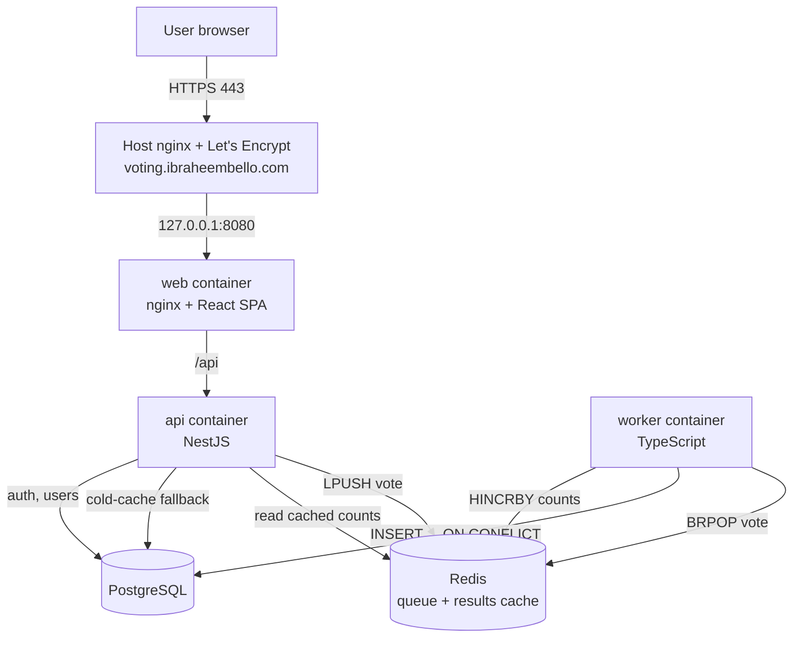

# CloudVote: Multi-Container Voting App

[](https://github.com/ibraheembello/multi-container-voting-app/actions/workflows/cicd.yml)

> **Live:** https://voting.ibraheembello.com

A real-time voting application built as a set of cooperating containers. People
sign in, cast one vote, and watch results update live. Votes are accepted
instantly onto a Redis queue and persisted asynchronously by a worker, so the
write path stays fast under load and the read path is served from a cache.

This is a cloud-computing capstone: the application itself is deliberately
focused, and the **architecture, containerisation, CI/CD and cloud deployment**
are the main work.

---

## Objectives

- Show a multi-container app with an asynchronous worker and a cache, not just a
  single monolith.
- One account, one vote, enforced both in the app and at the database.
- Automate build, test and deployment with GitHub Actions.
- Deploy to AWS behind nginx with HTTPS, health checks and centralised logs.

---

## Architecture



**Vote flow.** The API validates the request, flips `has_voted` to true in a
single atomic `UPDATE ... WHERE has_voted = false`, and pushes the vote onto a
Redis list. It returns immediately. The worker pops votes with a blocking
`BRPOP`, inserts them with `ON CONFLICT (user_id) DO NOTHING` (so retries never
double-count), and increments the cached counts. The results endpoint reads
those counts straight from Redis, rebuilding from PostgreSQL only on a cold
cache.

### Services

| Service   | Tech                     | Role                                             |
| --------- | ------------------------ | ------------------------------------------------ |
| `web`     | React + Vite, nginx      | SPA, served and proxies `/api` to the API        |
| `api`     | NestJS (TypeScript)      | Auth, voting, results, admin, health             |
| `worker`  | Node.js (TypeScript)     | Drains the vote queue, writes DB, updates cache  |
| `db`      | PostgreSQL 16            | System of record (users, votes, polls)           |
| `redis`   | Redis 7                  | Vote queue + results cache                       |

---

## Tech stack

- **Frontend:** React 18, Vite, TypeScript, Tailwind CSS, Framer Motion
- **Backend:** NestJS, TypeORM, Passport JWT, bcrypt
- **Worker:** TypeScript, ioredis, node-postgres
- **Data:** PostgreSQL 16, Redis 7
- **Containers:** Docker, Docker Compose, multi-stage builds, non-root users
- **CI/CD:** GitHub Actions, GitHub Container Registry (GHCR)
- **Cloud:** AWS EC2, nginx reverse proxy, Let's Encrypt (Certbot), Route 53

---

## Features

- Email + password accounts with JWT sessions
- One vote per user, enforced atomically and with a unique index
- Live results with a leaderboard that updates every few seconds
- Admin dashboard: turnout, totals, queue depth, per-option results, recent votes
- Redis caching of results, with a PostgreSQL fallback
- `/health` endpoints on the API and worker, and Docker health checks on every
  service
- Structured JSON logs from the worker; container logs collected by Docker

---

## Project structure

```
multi-container-voting-app/
├── api/                      # NestJS API (auth, vote, results, admin, health)
├── worker/                   # TypeScript queue worker
├── web/                      # React + Vite SPA (served by nginx)
├── nginx/                    # host reverse-proxy config for the EC2 box
├── deploy/                   # remote deploy + rollback script
├── docker-compose.yml        # local: builds everything
├── docker-compose.prod.yml   # prod: pulls GHCR images
├── .github/workflows/cicd.yml
├── .env.example
└── README.md
```

---

## Run it locally

Prerequisites: Docker and Docker Compose.

```bash
git clone https://github.com/ibraheembello/multi-container-voting-app.git
cd multi-container-voting-app
cp .env.example .env     # the defaults work for local use
docker compose up --build
```

Open http://localhost:8080. Register an account and vote. Sign in with the
seeded admin (`ADMIN_EMAIL` / `ADMIN_PASSWORD` from `.env`) to see the admin
dashboard.

---

## Configuration

All configuration comes from environment variables (`.env`, never committed).

| Variable            | Purpose                                      |
| ------------------- | -------------------------------------------- |
| `POSTGRES_USER`     | database user                                |
| `POSTGRES_PASSWORD` | database password                            |
| `POSTGRES_DB`       | database name                                |
| `JWT_SECRET`        | signing secret for session tokens            |
| `JWT_EXPIRES_IN`    | token lifetime (default `7d`)                |
| `ADMIN_EMAIL`       | seeded admin account (created on first boot) |
| `ADMIN_PASSWORD`    | seeded admin password                        |
| `REDIS_URL`         | Redis connection string                      |
| `DATABASE_URL`      | PostgreSQL connection string                 |

---

## API

All routes are under `/api`.

| Method | Route             | Auth   | Purpose                        |
| ------ | ----------------- | ------ | ------------------------------ |
| POST   | `/auth/register`  | no     | create an account, get a token |
| POST   | `/auth/login`     | no     | sign in, get a token           |
| GET    | `/auth/me`        | user   | current account                |
| GET    | `/poll`           | no     | the active poll and options    |
| POST   | `/votes`          | user   | cast a vote (once)             |
| GET    | `/results`        | no     | live results                   |
| GET    | `/admin/stats`    | admin  | dashboard statistics           |
| GET    | `/health`         | no     | API liveness (db + redis)      |

The worker exposes its own `/health` on port 4100 inside the network.

---

## CI/CD

`.github/workflows/cicd.yml` runs on every push and pull request to `main`:

1. **Test**: lint and unit-test the API and worker, lint and build the frontend
   (matrix job, one per package).
2. **Build and push**: on `main`, build the `api`, `worker` and `web` images
   and push them to GHCR, tagged with the commit SHA and `latest`.
3. **Deploy**: SSH to the EC2 host, pull the SHA-tagged images, roll the stack
   with `docker compose`, smoke-test `/api/health`, and roll back to the last
   known-good tag if the smoke test fails.

Images are tagged with the commit SHA (not only `latest`) so a rollback is a
one-line redeploy.

---

## Deployment

The app runs on an AWS EC2 host behind the host nginx, which terminates TLS for
`voting.ibraheembello.com` and proxies to the web container.

One-time host setup is documented in [`deploy/README.md`](deploy/README.md):
install Docker, create `~/voting/.env`, add the nginx site, point DNS at the
box, and issue a certificate with Certbot. After that, every push to `main`
deploys automatically.

### Security

- No secrets in git: `.gitignore` blocks `.env`; `.env.example` holds no real
  values; deploy secrets live in GitHub Actions secrets and in a `chmod 600`
  `.env` on the server.
- PostgreSQL and Redis are never published to the internet; only nginx (80/443)
  and SSH (22) are open.
- Passwords are hashed with bcrypt. App containers run as non-root users.
- The web and API containers publish only on `127.0.0.1`; the host nginx is the
  single public entry point.

---

## Monitoring

- **Health:** `/api/health` checks the database and Redis; the worker has its
  own health endpoint. Every container has a Docker `healthcheck`, so an
  unhealthy service is visible in `docker compose ps` and never receives traffic
  before it is ready.
- **Logs:** the worker emits structured JSON lines; container logs are collected
  by the Docker logging driver and viewed with `docker compose logs`.

---

## Troubleshooting

- **A container shows `unhealthy`:** check `docker compose logs <service>`. The
  API waits and retries if the database is still starting.
- **Votes are accepted but results do not move:** the worker drains the queue;
  check `docker compose logs worker` and that Redis is healthy. Results rebuild
  from the database on the next read if the cache was cleared.
- **`You have already voted`:** expected. Each account votes once. Use a new
  account to vote again.
- **Frontend loads but API calls fail locally:** make sure the whole stack is up
  (`docker compose ps`); the SPA calls `/api` on the same origin through nginx.

---

## Team

- Ibraheem Bello: design, backend, frontend, DevOps and deployment
